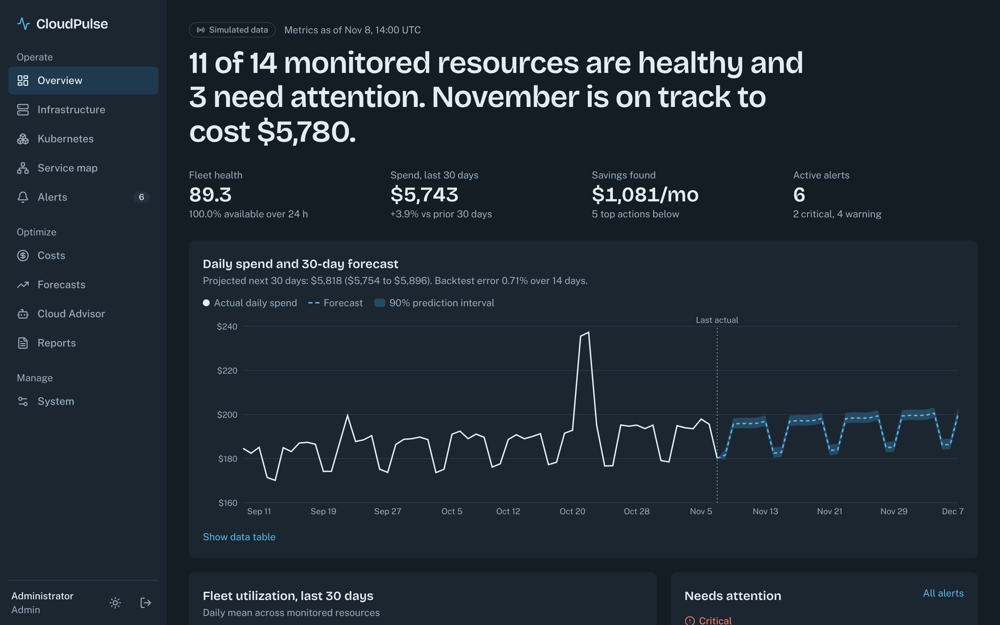
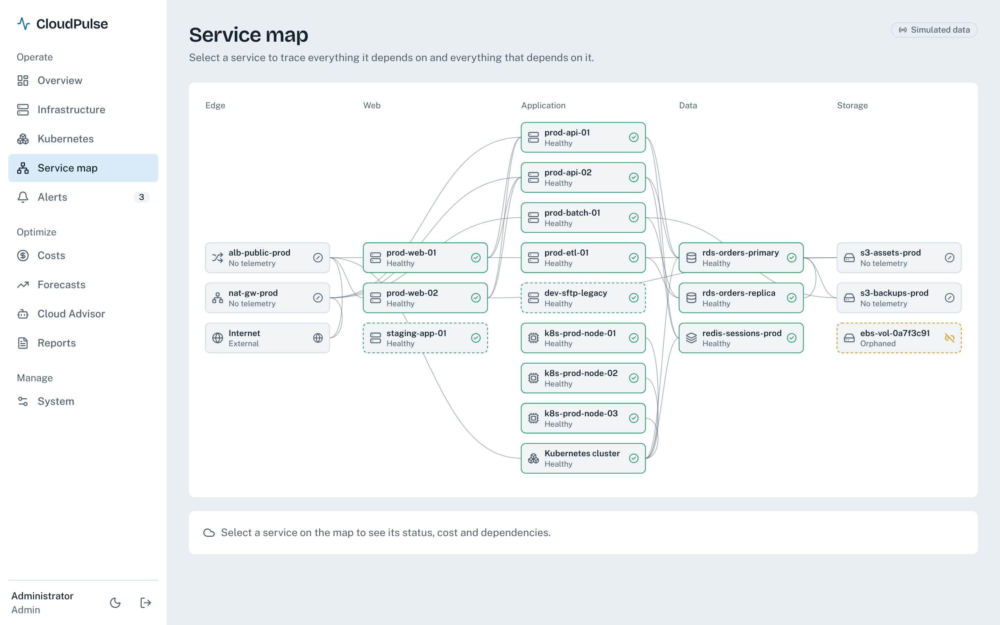
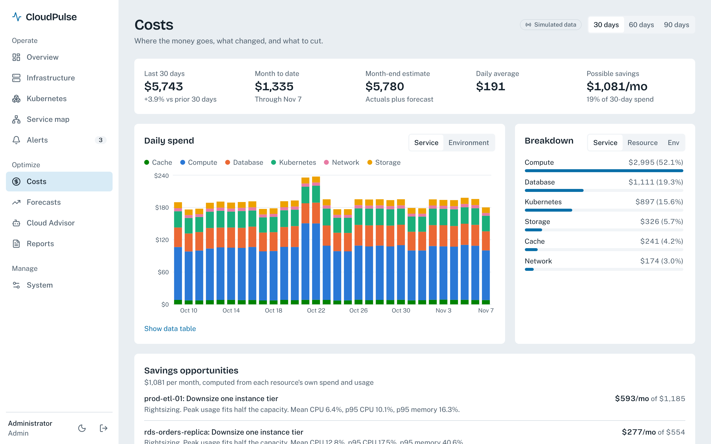
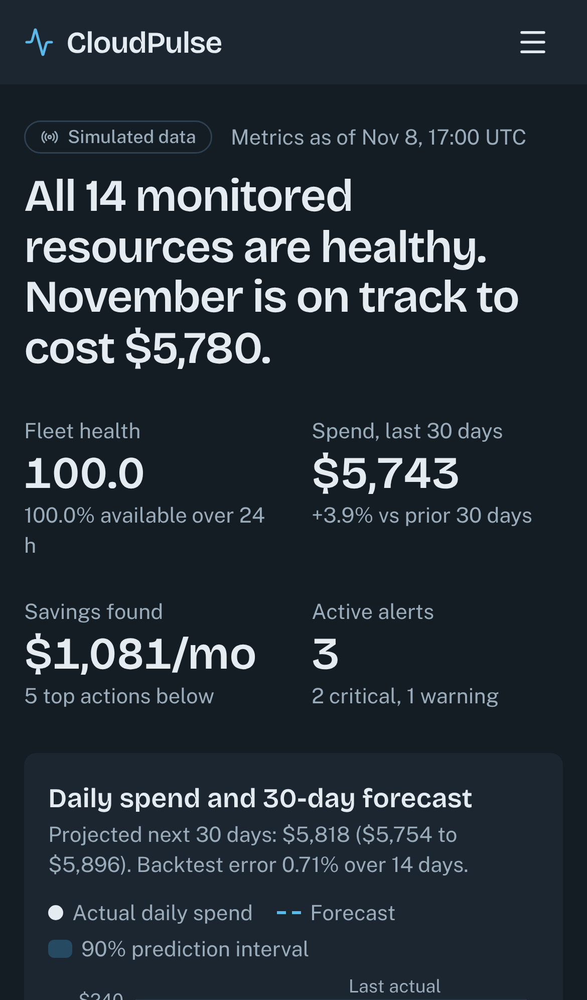
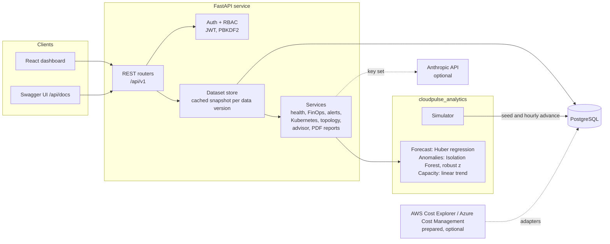

# CloudPulse

**Intelligent cloud operations, observability and cost optimization platform.**

CloudPulse monitors infrastructure health, analyzes and forecasts cloud spend, detects anomalies and capacity
risks, raises alerts, and explains it all through an AI Cloud Advisor. It runs end to end without a paid cloud
account: a deterministic simulated environment stands in for AWS or Azure, and every response is labeled with its
`data_source` so simulated figures are never presented as real ones.

**Live demo:** https://cloudpulse-wx5v.onrender.com (choose **View the demo**; read-only, simulated data. The free host can take about a minute to wake.)

[](https://github.com/ghaadii99aa-create/cloudpulse-platform/actions/workflows/ci.yml)

## Project status

| Phase | Scope | Status |
|---|---|---|
| 1. Analytics core | Simulated fleet, billing and telemetry; forecasting, anomaly detection, capacity, FinOps rules | Done, 21 tests |
| 2. Backend API | FastAPI, PostgreSQL, JWT auth and roles, alerts, advisor, PDF reports, CI | Done, 61 tests on PostgreSQL and SQLite |
| 3. Frontend | React, TypeScript, Tailwind dashboard with dark and light themes | Done, 26 unit and 28 end-to-end tests |
| 4. Platform | Docker Compose stack, Kubernetes manifests, Terraform for AWS, Prometheus and Grafana | Done, deployed to a kind cluster in CI |
| 5. Deployment | Hosted API, frontend and database with a public demo | Done, see [docs/DEPLOYMENT.md](docs/DEPLOYMENT.md) |

## Screens



| Service map | Costs | Phone |
|---|---|---|
|  |  |  |

All figures in the screenshots come from the simulated environment.

## Architecture



The simulation clock advances with real time: once a minute the API appends any hours (metrics) and days (billing)
that have elapsed, so the demo always shows current data. Analytics run once per data version and are cached.

## Features

- **Infrastructure monitoring:** CPU, memory, disk, network and availability per resource; hourly or daily history;
  health status with reasons; a fleet health score with its formula in the response; simulated live readings.
- **FinOps:** 30-day spend and change, cost by service, resource or environment, daily cost series, month-end
  estimate, cost spike detection, and optimization recommendations with savings computed from each resource's own spend.
- **Predictive analytics:** spend forecast with a 90% prediction interval and a 14-day backtest, utilization
  forecasts, Isolation Forest usage anomalies, capacity exhaustion estimates.
- **Alerts:** CPU, memory, availability, cost and capacity rules with configurable thresholds; de-duplication by
  fingerprint, auto-resolve, acknowledge and resolve, full history.
- **Kubernetes:** simulated cluster (nodes from telemetry, deployments, pods, eviction under pressure) and an optional
  live mode through the official client that falls back visibly when no cluster is reachable.
- **Topology:** dependency graph of the environment with per-node status and cost.
- **AI Cloud Advisor:** with `ANTHROPIC_API_KEY`, Claude answers from the computed facts only; without it, a
  rule-based writer answers. Every response states `mode: "ai"` or `mode: "fallback"`.
- **Reports:** executive PDF with KPIs, cost charts, anomalies, forecast, performance table, recommendations, alerts.
- **Dashboard:** executive overview, infrastructure with simulated live readings, per-resource history, costs, forecasts,
  Kubernetes, interactive service map, alerts, advisor, PDF download and user administration, in dark and light themes
  and at phone width. Every page shows the `data_source` its response reported, and controls follow the signed-in role.
- **Observability:** `/metrics` with request telemetry and platform figures labeled by `data_source`, six Prometheus
  alert rules with unit tests, and a provisioned Grafana dashboard.
- **Security:** PBKDF2-SHA256 (600k iterations), JWT, three roles, login rate limiting, timing-safe login,
  input validation, a consistent error envelope, secrets only from environment variables.

## Run it locally

Requirements: Docker, or Python 3.11+.

```bash
cp .env.example .env          # set JWT_SECRET, POSTGRES_PASSWORD, ADMIN_EMAIL, ADMIN_PASSWORD
docker compose up --build     # dashboard on http://localhost:8080, API docs on http://localhost:8000/api/docs
```

Add Prometheus (port 9090) and Grafana (port 3000) by setting `GRAFANA_ADMIN_PASSWORD` and running
`docker compose --profile monitoring up --build`. See [infrastructure/README.md](infrastructure/README.md) for
Kubernetes and Terraform.

To work on the dashboard with hot reload (Node 20.19 or later), run it on http://localhost:5173. It proxies `/api` to port 8000:

```bash
cd frontend && npm ci && npm run dev
```

Without Docker:

```bash
python -m venv .venv && source .venv/bin/activate
pip install ./analytics -r backend/requirements-dev.txt
cd backend
ADMIN_EMAIL=you@example.com ADMIN_PASSWORD='choose-a-long-one-1' uvicorn app.main:app --reload
```

With no `DATABASE_URL` the API uses a local SQLite file, which is fine for development.

## Tests

```bash
cd analytics && python -m pytest        # 21 tests
cd backend && python -m pytest          # 61 tests (SQLite); set TEST_DATABASE_URL for PostgreSQL
cd frontend && npm test                 # 26 unit tests
cd frontend && npm run build && npm run test:e2e   # 28 browser tests; needs the API and E2E_* accounts, see below
```

GitHub Actions runs lint, the analytics suite, the backend suite against both PostgreSQL 16 and SQLite, then builds
the frontend (lint, types, unit tests, build, browser tests against the real API), then builds the Docker image and
smoke-tests it (login, dashboard, PDF download). Platform jobs validate the manifests and alert rules, run Terraform
checks with a mocked provider, start the whole Compose stack, and deploy to a real kind cluster where a script checks
login, both replicas, Prometheus, Grafana, replica replacement, database persistence and NetworkPolicy enforcement.

The end-to-end suite drives the production build in Chromium at desktop and phone sizes against a running API, in both
themes, with a WCAG 2 A/AA scan of every page. Set `E2E_ADMIN_EMAIL`, `E2E_ADMIN_PASSWORD`, `E2E_VIEWER_EMAIL` and
`E2E_VIEWER_PASSWORD` to accounts on a throwaway database, because the suite acknowledges alerts.

## Repository layout

```
analytics/        cloudpulse_analytics package and its tests
backend/          FastAPI service (app/), tests, Dockerfile
frontend/         React dashboard (src/), unit tests, Playwright tests (e2e/)
docs/screenshots  Images used in this README
infrastructure/   Kubernetes manifests, Terraform, Prometheus rules, Grafana dashboards, cluster verification script
docs/API.md       endpoint reference, roles, error format, methods behind every number
.github/workflows CI pipeline
docker-compose.yml
```

## Configuration

All settings come from environment variables; see [.env.example](.env.example). Nothing secret has a default, and
`ENVIRONMENT=production` refuses to start without `JWT_SECRET`.

## Data honesty

Resource names, prices and usage are generated. Hourly prices are illustrative, not provider list prices. The
simulator plants two cost incidents and a growing database disk so the detectors have something real to find; the
tests check that the detectors find exactly those and raise no false alarms on clean data.
